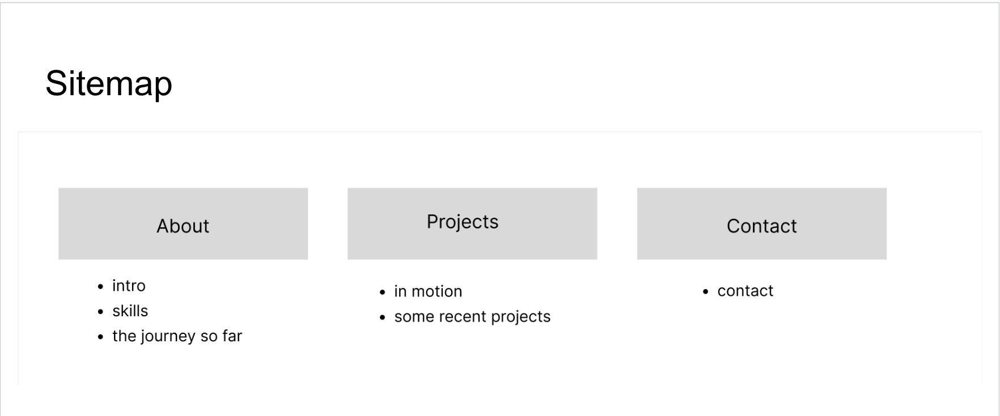

## Live Website

[View my Midterm website](https://rebeccashinyan.github.io/WebDevClass/HW%20%26%20Projects/Midterm/)

## Website Concept

This portfolio is designed to help potential employers, collaborators, and anyone interested in my work learn more about me. It includes a brief introduction, my skills, my journey so far (including past internship experiences), and a selection of relevant projects I've worked on.

The visual style is inspired by vintage European towns, incorporating elements such as postcards, handwritten notes, botanical illustrations, vintage signs, and flowers. I wanted to create a website that feels personal, creative, and playful while reflecting my personality and design style.

